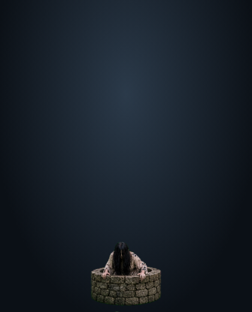
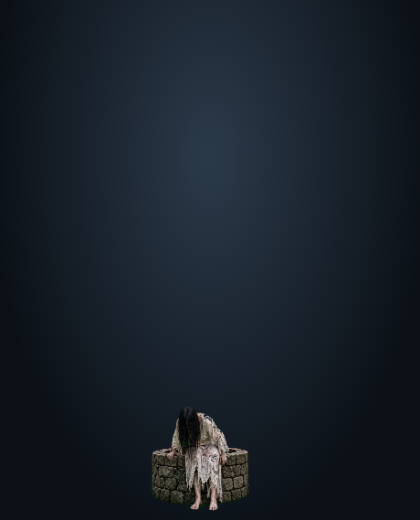
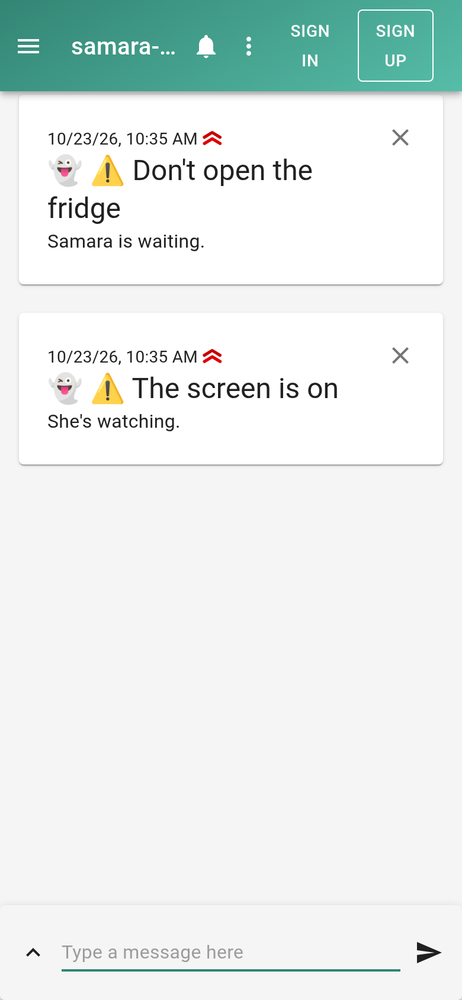

# Samara

She will haunt you in various ways.

## Videos

- [Samara full demo, desktop and fridge, on YouTube](https://youtu.be/lnmafY6e5C8)
- [Samara desktop demo on YouTube](https://www.youtube.com/watch?v=k8nw7NfwKpU)
- [Samara on the fridge on YouTube](https://www.youtube.com/watch?v=Z-YdzodCmnc)

## Origin
The initial idea was to make an app people could install on smart fridges.
I can show how it works (video), but that means nothing without approval.
So in addition to stalking everyone's fridge, she can stalk your phone and desktop.
Samara remembers.
This week proved to us all that everything can be hacked, and October really is Spooktober

I started out prototyping a Tizen app for my Samsung fridge, then discovered that Samsung takes two weeks or more to approve an app. Samara does not wait two weeks, so she moved to desktops and phones instead.

## Desktop
Without warning, she crawls out of a well somewhere on your screen and begins walking toward you.
Click her, and she vanishes in a puff of logic.

```bash
cd desktop
npm install
npm start
```

If macOS blocks Electron:
```bash
xattr -cr node_modules/electron/dist/Electron.app
```

### Controls
- **Click / push her**: she disappears and the whole screen glitches for about 1.3 s (RGB bands, tearing, static, scanlines)
- **Ctrl+Shift+S** (Cmd+Shift+S) — summon now (for testing)
- **Ctrl+Shift+R** — dismiss

### Behavior
- Starts on the empty well, then she climbs out and walks
- Appears at a random position
- Comes slightly closer during the walk
- Default interval: every 3 hours (change `INTERVAL_MS` in `desktop/main.js`)
- First appearance ~2 seconds after launch so you can test

## Phone
Subscribe once. Messages arrive through the day via ntfy.

Open `ntfy/index.html` (or the hosted page).
Queue the day's messages with:
```bash
cd ntfy
python publish.py
```

## Media
The well artwork is in `media/`.

## Screenshots

### Desktop
She climbs out of the well and walks toward you.

[Watch the desktop demo video (19 s, with sound)](media/samara-desktop-demo.mp4). When she vanishes, the whole screen glitches for about 1.3 s.

<p>



</p>

### Phone (ntfy)
Subscribe page and the messages as they arrive in ntfy.

<p>


</p>
